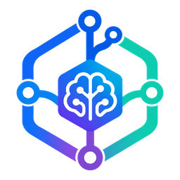

<p align="center"></p>

# Next Agent

Local-first, cross-platform AI workstation: coding agents + Markdown knowledge vault + auditable permission engine, built on Tauri 2.

Status: **M1 in progress** — scaffold complete; see [M1 Progress](docs/plan/M1%20Progress.md).

- Plan & roadmap: [docs/plan/Roadmap.md](docs/plan/Roadmap.md)
- First milestone task breakdown: [docs/plan/M1 Vertical Slice.md](docs/plan/M1%20Vertical%20Slice.md)
- Documentation vault entry point: [docs/Home.md](docs/Home.md)

## Tests
```sh
node scripts/test.mjs        # TypeScript suites (no dependencies needed)
cargo test --workspace       # requires Rust
```

The `docs/` folder is a self-contained Markdown vault (Obsidian/Logseq compatible, `[[wikilinks]]`). Open `docs/` as a vault to browse it.
