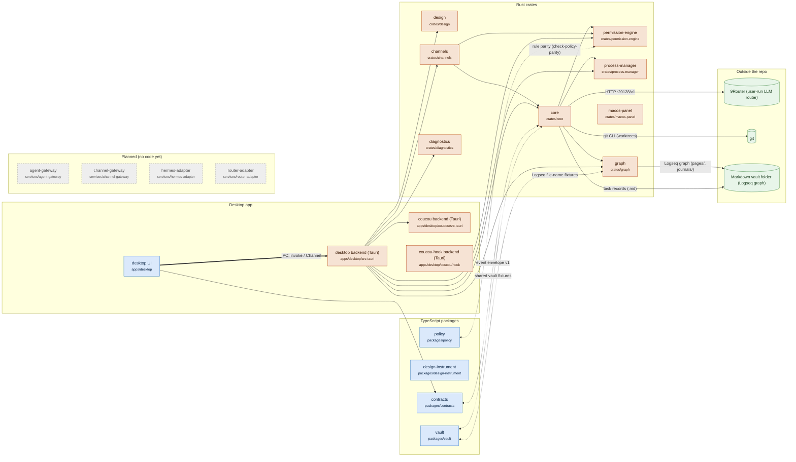

# Project Topology

How the separate projects in this repo connect. **Generated** by `node scripts/gen-topology.mjs` (`make topology`) from the Cargo and package manifests plus a few probed cross-language links; `make check` fails if this note is stale. Don't edit by hand.

See [[Architecture Overview]] for what each box does and [[Module Boundaries]] for the rules behind the arrows.

**Legend:** solid arrow = depends on (manifest) · dotted `dev` = test-only dependency · thick arrow = runtime IPC · dotted two-way = kept in sync across languages (parity checks / shared fixtures) · green = outside the repo · grey dashed = planned, README only.

| Project | Kind | Path | Depends on | Used by | Mirrors |
|---|---|---|---|---|---|
| core | Rust crate | `crates/core` | permission-engine, process-manager, graph | channels, desktop backend (Tauri) | contracts, vault |
| permission-engine | Rust crate | `crates/permission-engine` | — | core, channels, desktop backend (Tauri) | policy |
| process-manager | Rust crate | `crates/process-manager` | — | core, desktop backend (Tauri) | — |
| graph | Rust crate | `crates/graph` | — | core, desktop backend (Tauri) | vault |
| design | Rust crate | `crates/design` | — | desktop backend (Tauri) | — |
| macos-panel | Rust crate | `crates/macos-panel` | — | — | — |
| channels | Rust crate | `crates/channels` | core, permission-engine | desktop backend (Tauri) | — |
| diagnostics | Rust crate | `crates/diagnostics` | — | desktop backend (Tauri) | — |
| desktop backend (Tauri) | Rust crate | `apps/desktop/src-tauri` | core, permission-engine, process-manager, graph, coucou backend (Tauri), channels, design, diagnostics | desktop UI | — |
| coucou backend (Tauri) | Rust crate | `apps/desktop/coucou/src-tauri` | — | desktop backend (Tauri) | — |
| coucou-hook backend (Tauri) | Rust crate | `apps/desktop/coucou/hook` | — | — | — |
| desktop UI | TS package | `apps/desktop` | contracts, desktop backend (Tauri) | — | — |
| contracts | TS package | `packages/contracts` | — | desktop UI | core |
| design-instrument | TS package | `packages/design-instrument` | — | — | — |
| policy | TS package | `packages/policy` | — | — | permission-engine |
| vault | TS package | `packages/vault` | — | — | core, graph |
| agent-gateway | planned (stub) | `services/agent-gateway` | — | — | — |
| channel-gateway | planned (stub) | `services/channel-gateway` | — | — | — |
| hermes-adapter | planned (stub) | `services/hermes-adapter` | — | — | — |
| router-adapter | planned (stub) | `services/router-adapter` | — | — | — |
